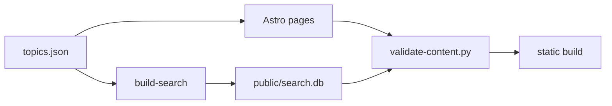

<div align="center">

# Interactive Atlas

**A manipulable science atlas — 1,352 curriculum topics across nine sciences.**

[](https://adineo-cmd.github.io/interactive-science/)
   

[](https://github.com/adineo-cmd/interactive-science/stargazers) [](https://github.com/adineo-cmd/interactive-science/commits)

[Live site](https://adineo-cmd.github.io/interactive-science/) · [Quick start](#quick-start) · [How it works](#how-it-works) · [Features](#features)

</div>

---

Every lesson is built from an instrument rather than a paragraph: plots,
slider labs, timelines, derivations and vector diagrams. The curriculum covers
physics, chemistry, biology, mathematics, astronomy, earth science, materials,
environmental science, medicine and more.

The current map holds **142 subject entries, 1,352 topics and 583 live lessons**.
Planned topics are shown in the curriculum so the expert path is visible before
the page exists.

## Features

| | Feature | What it does |
| --- | --- | --- |
| 🎛️ | **Instrument-first lessons** | Slider labs, plots, timelines and derivations instead of static text. |
| 🗺️ | **Full curriculum map** | All four levels per subject, with planned topics marked as planned. |
| 🔎 | **Offline search** | Client-side SQLite over a build-time index — no search server. |
| 📓 | **Field-notebook design** | Paper, hairlines and subject inks, with no framework islands. |

## How it works

`topics.json` is the single source of truth:

1. Navigation, subject pages, homepage counts and the search index all read
   `astro-website/src/data/topics.json`.
2. Each live topic is a page in `astro-website/src/pages/` that configures its
   widgets from `astro-website/public/widgets/`.
3. `npm run build-search` regenerates `public/search.db` with sql.js.
4. `scripts/validate-content.py` checks every live topic has a page before the
   site is built.



## Quick start

**Develop**

```bash
cd astro-website
npm install
npm run build-search          # rebuild public/search.db
npm run dev                   # http://localhost:4321/interactive-science/
```

**Validate and build**

```bash
python3 scripts/validate-content.py
npm run build                 # static output in dist/
```

## Project structure

```text
astro-website/
  src/data/topics.json   curriculum map
  src/pages/             one page per live topic
  public/widgets/        pure-JS instruments
  scripts/               search index + validation
pipeline/
  batches/               generation batches
  packs/                 reusable content packs
docs/                    pedagogy and roadmap notes
```

## Deployment

Every push to `main` builds the site and deploys it to GitHub Pages
through `.github/workflows/deploy.yml`:

**https://adineo-cmd.github.io/interactive-science/**

The output is fully static — no server, no database, no runtime environment
variables.

## Adding a lesson

1. Add the topic to `astro-website/src/data/topics.json`.
2. Create `astro-website/src/pages/<slug>.astro` from an existing topic page.
3. Run `npm run build-search && python3 scripts/validate-content.py`.
4. Open a pull request.

`PEDAGOGY.md` and `ROADMAP.md` explain the teaching model and what is planned.
